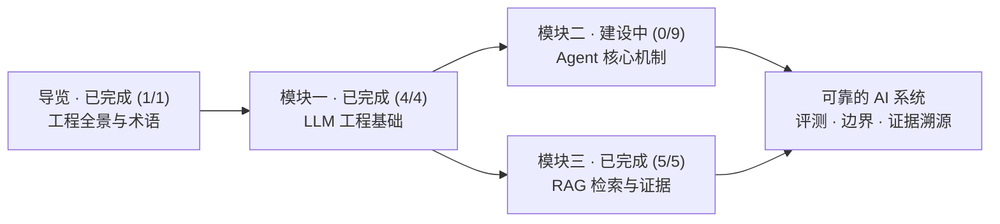

# AI Agent Guide

[English](README.md) | **简体中文**

> **在线交互阅读**：**https://qufei1993.github.io/ai-agent-fullstack-roadmap/**  
> 直达入口：[中文版](https://qufei1993.github.io/ai-agent-fullstack-roadmap/zh/index.html) · [English Edition](https://qufei1993.github.io/ai-agent-fullstack-roadmap/en/index.html)

面向软件工程师的零构建**开源交互式 AI Agent 工程指南**。每一章都将精炼的工程原理与浏览器交互实验台结合，支持调参、透视 Payload 与验证边界条件，并在同仓提供可运行参考代码。

- **核心机制与语言无关**：参考代码默认使用 TypeScript，所有工程模式与架构权衡同样适用于 Python、Go、Java 等技术栈。
- **聚焦核心边界**：重点覆盖 LLM 约束、Agent 执行机制与 RAG 证据链路，不包含重型商业 SaaS 脚手架、模型后训练（SFT / RL）或复杂多 Agent 编排。

## 学习路线图



> **编排原则**：尽早跑通最小 Agent，完整 RAG 并非理解工具调用、执行循环与边界控制的前置条件；安全、评测、可观测性与成本控制贯穿每个模块。

## 内容大纲（共 19 篇 · 已双语上线 10 篇）

全站章节状态与双语信息由 [`docs/chapters.json`](docs/chapters.json) 统一维护。

### 导览 · 全局坐标与术语

| 序号 | 章节 | 核心内容 | 在线阅读 |
| --- | --- | --- | --- |
| 1 | **AI Agent 工程全景图** | 通过一次完整任务说明 LLM、上下文、工具、记忆、RAG 与 Harness 的协作关系，并提供易混概念术语速查。 | [中文](https://qufei1993.github.io/ai-agent-fullstack-roadmap/zh/agent-architecture-map.html) · [EN](https://qufei1993.github.io/ai-agent-fullstack-roadmap/en/agent-architecture-map.html) |

### 模块一 · LLM 工程基础

| 序号 | 章节 | 核心内容 | 在线阅读 |
| --- | --- | --- | --- |
| 2 | **Prompt Engineering** | 讲清模型调用、采样参数、任务约束与 Few-shot，理解 Prompt 能解决什么、不能解决什么。 | [中文](https://qufei1993.github.io/ai-agent-fullstack-roadmap/zh/prompt-engineering.html) · [EN](https://qufei1993.github.io/ai-agent-fullstack-roadmap/en/prompt-engineering.html) |
| 3 | **结构化输出与结果校验** | 使用 JSON Schema 与 Zod 建立输出契约，处理格式错误、业务校验失败与有限重试。 | [中文](https://qufei1993.github.io/ai-agent-fullstack-roadmap/zh/structured-output.html) · [EN](https://qufei1993.github.io/ai-agent-fullstack-roadmap/en/structured-output.html) |
| 4 | **Context Engineering** | 理解上下文来源、信息位置与预算，通过筛选、组织和按需加载提高有效信息比例。 | [中文](https://qufei1993.github.io/ai-agent-fullstack-roadmap/zh/context-engineering.html) · [EN](https://qufei1993.github.io/ai-agent-fullstack-roadmap/en/context-engineering.html) |
| 5 | **Prompt 回归评测** | 建立用例集、评分规则与版本门禁，验证 Prompt、模型和参数改动是否带来退步。 | [中文](https://qufei1993.github.io/ai-agent-fullstack-roadmap/zh/prompt-regression.html) · [EN](https://qufei1993.github.io/ai-agent-fullstack-roadmap/en/prompt-regression.html) |

### 模块二 · Agent 核心机制

| 序号 | 章节 | 核心内容 | 状态 |
| --- | --- | --- | --- |
| 6 | Tool Calling 与 Mini Agent Loop | 从工具声明、参数校验、执行分发到结果回传，逐步实现一个具有停止条件的最小 Agent。 | 待上线 |
| 7 | Workflow 与 Agent 的架构选择 | 比较顺序、路由、并行和动态循环，判断哪些步骤交给代码、哪些交给模型。 | 待上线 |
| 8 | 任务规划与反馈修正 | 实现任务拆解、计划执行与动态调整，利用测试和工具反馈修正结果，并验证收益。 | 待上线 |
| 9 | Harness 与执行边界 | 通过权限校验、人工审批、执行隔离和资源预算，控制 Agent 可以做什么以及何时必须停止。 | 待上线 |
| 10 | 记忆管理与上下文压缩 | 区分工作记忆与长期记忆，处理信息的写入、检索、更新、遗忘及历史压缩。 | 待上线 |
| 11 | 任务状态与中断恢复 | 使用检查点、操作记录和幂等机制，处理超时、重试、进程中断及重复执行。 | 待上线 |
| 12 | 流式交互与执行状态展示 | 将文本生成、工具执行和审批事件映射到界面，处理取消、断线与恢复后的状态同步。 | 待上线 |
| 13 | MCP 与 Skills 扩展机制 | 理解协议接入与任务知识封装的区别，实现外部工具连接和 Skills 按需加载。 | 待上线 |
| 14 | Agent 评测与轨迹诊断 | 结合最终环境状态和执行轨迹，评估任务成功率、约束遵守、成本与延迟，并定位失败原因。 | 待上线 |

### 模块三 · RAG 检索与证据

| 序号 | 章节 | 核心内容 | 在线阅读 |
| --- | --- | --- | --- |
| 15 | **文档解析与分块策略** | 将原始文档转为保留结构和来源的检索单元，对比不同分块方式对证据完整性的影响。 | [中文](https://qufei1993.github.io/ai-agent-fullstack-roadmap/zh/document-parsing-chunking.html) · [EN](https://qufei1993.github.io/ai-agent-fullstack-roadmap/en/document-parsing-chunking.html) |
| 16 | **Embedding 与向量检索** | 理解语义向量、相似度与召回边界，跑通索引、查询、元数据过滤和内容更新。 | [中文](https://qufei1993.github.io/ai-agent-fullstack-roadmap/zh/embedding-vector-search.html) · [EN](https://qufei1993.github.io/ai-agent-fullstack-roadmap/en/embedding-vector-search.html) |
| 17 | **混合检索、查询改写与重排** | 组合关键词与向量召回，通过查询改写、RRF 和 Reranker 改善候选证据的覆盖与排序。 | [中文](https://qufei1993.github.io/ai-agent-fullstack-roadmap/zh/hybrid-search-reranking.html) · [EN](https://qufei1993.github.io/ai-agent-fullstack-roadmap/en/hybrid-search-reranking.html) |
| 18 | **引用溯源与证据校验** | 将回答中的论断绑定到来源，识别不受证据支持的内容，并处理证据冲突、不足和拒答。 | [中文](https://qufei1993.github.io/ai-agent-fullstack-roadmap/zh/citation-hallucination.html) · [EN](https://qufei1993.github.io/ai-agent-fullstack-roadmap/en/citation-hallucination.html) |
| 19 | **RAG 评测与 Agentic RAG** | 分别评估检索和回答质量，对比固定检索流程与 Agent 自主检索，判断动态检索是否值得引入。 | [中文](https://qufei1993.github.io/ai-agent-fullstack-roadmap/zh/rag-evaluation-agentic-rag.html) · [EN](https://qufei1993.github.io/ai-agent-fullstack-roadmap/en/rag-evaluation-agentic-rag.html) |

## 目录结构

```text
.
├── docs/                           # GitHub Pages 静态站点根目录（零构建，完全隔离）
│   ├── index.html                  # 语言自动路由页
│   ├── chapters.json               # 双语章节目录、siteUrl 与上线状态唯一索引
│   ├── sitemap.xml                 # 自动生成的双语站点地图
│   ├── robots.txt                  # 自动生成的爬虫协议
│   ├── shared/
│   │   ├── tokens.css              # 全局设计 Token、暗黑模式与通用组件样式
│   │   └── site.js                 # 全局导航、浮动目录、中英切换
│   ├── en/                         # 英文交互章节
│   └── zh/                         # 中文交互章节
├── examples/                       # 与章节配套的可运行 TypeScript 示例
├── scripts/
│   └── generate-seo.mjs            # 同步全站 SEO 标签、sitemap.xml 与 robots.txt
└── skills/
    └── interactive-book-chapter/   # 章节生成与维护专用 Agent Skill
```

## 本地预览与运行示例

预览交互站点（零构建，无需安装依赖）：

```bash
npm run preview
```

启动后打开[中文版](http://localhost:8766/zh/index.html)或[英文版](http://localhost:8766/en/index.html)（可用 `PORT=4173 npm run preview` 自定义端口）。

运行配套示例（Node.js `>= 22.0.0`）：

```bash
cp .env.example .env
npm install
npx tsx --env-file=.env examples/ai-coding/prompt-engineering/01-temperature.ts
```

更新章节或目录后，同步全站 SEO 标签与站点地图：

```bash
npm run seo:sync
```
